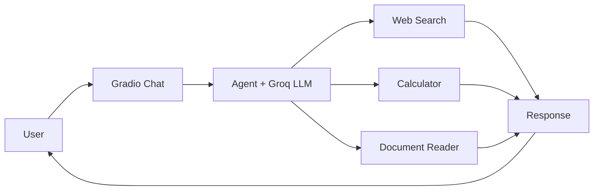

<div align="center">

# 🤖 Multi-Tool Autonomous AI Research Agent

**An AI agent that searches the web, calculates, and reads your documents, all from one chat.**


</div>

<!-- Add a screenshot:  -->

## ✨ Overview

Instead of relying on text generation alone, this agent decides which tool to use for each request and combines the results into a clear answer. Built with **Python, LangChain, Groq, and Gradio**.

## 🚀 Features

| Tool | What it does |
| --- | --- |
| 🔎 **Web Search** | Gathers up-to-date information for research questions |
| 🧮 **Python Calculator** | Solves math and numerical queries |
| 📄 **Document Reader** | Extracts text from uploaded files for analysis |
| 🧠 **Autonomous Tool Selection** | Picks the right tool based on the request |
| 💬 **Gradio Chat UI** | Simple, interactive conversation interface |

## 🏗️ How it works



## ⚙️ Quick start

```bash
git clone https://github.com/Maria-Chaudhary/Multi-Tool-Autonomous-AI-Agent.git
cd Multi-Tool-Autonomous-AI-Agent

python -m venv venv
venv\Scripts\activate          # Windows (macOS/Linux: source venv/bin/activate)

python -m pip install -r requirements.txt
```

Create a `.env` file in the project root:

```env
GROQ_API_KEY=your_groq_api_key
```

Add any extra search-provider keys your setup needs (DuckDuckGo or Tavily). Then run:

```bash
python main.py
```

Open the local Gradio URL shown in the terminal.

> 🔐 Never commit your `.env` file or expose API keys.

## 💡 Try asking

- *"Search for recent developments in AI and summarize the key findings."*
- *"Calculate compound interest on 50,000 at 8% annually for 3 years."*
- *"Upload a PDF and extract its important information."*

## 📁 Structure

```text
├── main.py            # App entry point and Gradio interface
├── tools.py           # Tool definitions and integrations
├── style.css          # Custom styling
├── requirements.txt   # Dependencies
└── README.md
```

## ⚠️ Limitations

- Answers depend on the chosen model, search provider, and API limits.
- Large documents may hit token or rate limits.
- AI output can be inaccurate, so verify important results.

## 🔮 Roadmap

- [ ] Retrieval-Augmented Generation (RAG)
- [ ] Conversation memory
- [ ] More specialized tools
- [ ] Public deployment

## 👩‍💻 Author

**Maria Rauf**: BS Information Technology Graduate | AI & Python Developer

[GitHub](https://github.com/Maria-Chaudhary) · [LinkedIn](https://www.linkedin.com/in/maria-rauf-925258279/)

<div align="center">

⭐ If you find this project useful, consider giving it a star!

</div>
