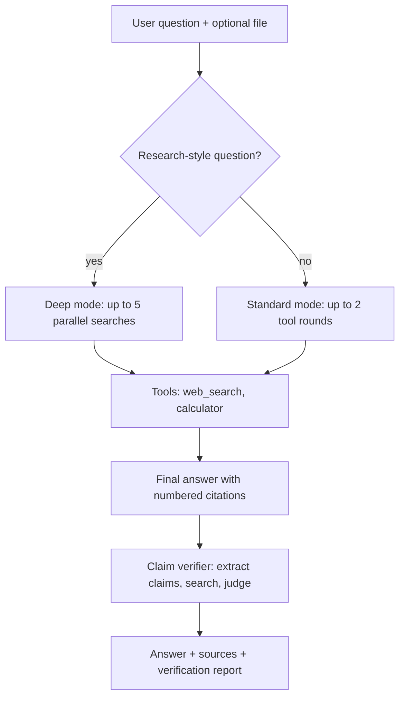

# 🧠 Research Copilot: Multi-Tool Autonomous AI Research Agent

An AI research assistant that searches the web, reads your documents, does calculations, cites its sources, and then **fact-checks its own answer**. Everything runs through one chat interface with a live dashboard showing what the agent is doing.


---

## The problem

Finding reliable information is slow. People search several websites, skim long documents, check numbers, and still have to ask whether what they found is true. This project explores how a tool-using AI agent can do the legwork and make its answers easier to review.

## Features

| Feature | What it does |
|---|---|
| 🌐 **Web research** | Searches the web and returns answers with numbered, clickable source references. |
| 📄 **Document analysis** | Reads uploaded PDF, DOCX, TXT, MD and CSV files and answers questions about them. |
| 🧮 **Safe calculator** | Evaluates arithmetic through a restricted parser (no `eval`). |
| 🔗 **Source references** | Citations like `[1]`, `[2]` in the answer, plus a *Sources & References* list of only the sources actually cited. |
| ✅ **Claim verifier** | Extracts key factual claims from the answer, searches for evidence, and reports each claim as supported, uncertain or contradicted. |
| ⚡ **Deep research mode** | Detects research-style questions (several items, comparisons, recommendations) and runs up to 5 searches in parallel, then writes one complete answer. |
| 📊 **Live dashboard** | Shows agent status, per-task progress cards, session statistics and an activity log. |

## How it works



1. The LLM decides whether it needs a tool and calls it through LangChain tool calling.
2. Search results are numbered so the model can cite them, and the app keeps the source list.
3. The final answer is generated in a clean, tool-free step, which avoids malformed tool calls.
4. If enabled, the verifier fact-checks up to three key claims with fresh searches.

## Tech stack

- **Language:** Python
- **LLM:** Groq API (default model `openai/gpt-oss-20b`)
- **Agent / tools:** LangChain (`langchain-core`, `langchain-groq`)
- **Web search:** Tavily (optional) or DuckDuckGo (`ddgs`)
- **Documents:** `pypdf`, `python-docx`
- **UI:** Gradio with custom CSS

## Project structure

```
.
├── app.py            # Gradio UI, agent loop, dashboard, citations
├── tools.py          # web_search, calculator, file reader
├── verifier.py       # Claim verification pipeline
├── style.css         # Dashboard styling
├── requirements.txt
├── .env              # Your API keys (never commit this file)
└── README.md
```

## Getting started

### 1. Clone and install

```bash
git clone https://github.com/YOUR-USERNAME/YOUR-REPO.git
cd YOUR-REPO
python -m venv .venv
# Windows: .venv\Scripts\activate    macOS/Linux: source .venv/bin/activate
pip install -r requirements.txt
pip install gradio
```

### 2. Add your API key

Create a `.env` file in the project folder:

```env
GROQ_API_KEY=your_groq_api_key
```

Get a free key from the [Groq Console](https://console.groq.com).

### 3. Run

```bash
python app.py
```

Open the local URL shown in the terminal (usually `http://127.0.0.1:7860`).

## Configuration

| Variable | Required | Default | Purpose |
|---|---|---|---|
| `GROQ_API_KEY` | Yes | none | Groq API key |
| `GROQ_MODEL` | No | `openai/gpt-oss-20b` | Model used for answers and verification (must support tool calling) |
| `GROQ_REASONING_EFFORT` | No | `low` | `low`, `medium`, `high` or `off` (gpt-oss models only) |
| `TAVILY_API_KEY` | No | none | More reliable web search on cloud hosts; DuckDuckGo is the fallback |

## Example questions

- *"What are the latest trends in e-commerce marketing in Pakistan? Cite your sources."*
- *"Research 5 practical ways a small online business can grow sales. Compare cost, benefit and difficulty, then recommend the best 2."*
- Upload a PDF and ask: *"Summarize the key points of this document."*
- *"What is (1250 * 0.18) + 340?"*

## Reliability design

Building this meant handling real failure modes of LLM agents:

- **Malformed tool calls:** extra or invented arguments are stripped before a tool runs, and duplicate calls are skipped.
- **Tool-call errors from the API:** the final answer is generated from a clean prompt with results as plain text, instead of replaying tool-call history.
- **Rate limits:** the app waits and retries when Groq's per-minute limit is hit.
- **Cut-off answers:** truncated replies are detected and continued automatically.
- **Search failures:** multiple search back ends, retries, timeouts and caching.
- **Safe file reading:** size limits, encrypted PDFs, scanned PDFs and missing packages are handled with clear messages.

## Limitations

- The claim verifier checks at most **3 claims** per answer and judges them from search snippets. It reduces risk but does **not guarantee** correctness. Always review the cited sources for important decisions.
- Scanned (image-only) PDFs are not supported because there is no OCR.
- Only the first 10 PDF pages are read, and long documents are truncated to limit token usage.
- On a free Groq tier, long research answers can be slow because of rate limits.
- DuckDuckGo may block cloud IP addresses; use `TAVILY_API_KEY` when deploying.
- Dashboard statistics are per session, and "Time Saved" is an estimate (not a measured value).
- Questions and uploaded text are sent to Groq. Do not upload confidential files.

## Roadmap

- [ ] Evaluation set to measure citation accuracy and verifier precision
- [ ] OCR for scanned documents
- [ ] Export research results as a PDF report
- [ ] Persistent conversation history
- [ ] Support for more LLM providers

## What I learned

- Designing reliable tool-calling loops around real API constraints
- Prompting and guarding against hallucinated sources
- Parallelizing tool calls to cut latency
- Building a responsive custom Gradio interface
- Deploying an LLM app on Hugging Face Spaces

## License

This project is licensed under the MIT License. Add a `LICENSE` file to the repository.

## Author

**Your Name**
[LinkedIn](https://www.linkedin.com/in/maria-rauf-925258279/) · [GitHub](https://github.com/Maria-Chaudhary)

*I'm open to AI automation and LLM/agent projects. Feel free to reach out.*
